
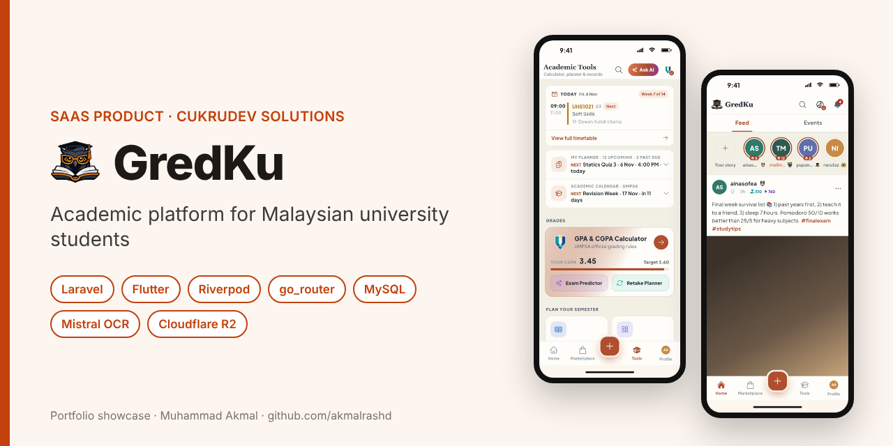

# GredKu — Academic Platform for Malaysian University Students

> **Portfolio showcase.** GredKu is a live product of CukruDev Solutions, so the source code is private.
> This repository explains what I built, how it is designed, and the decisions behind it.

🌐 **Website:** [gredku.com](https://gredku.com) · 📱 **App beta:** [app.gredku.com](https://app.gredku.com)  
**Company:** CukruDev Solutions (student startup registered under the Faculty of Computing, UMPSA)  
**Role:** Full Stack & Mobile Developer · **Period:** May 2026 – present

---

## What it is

Every Malaysian public university (IPTA) grades a little differently: different grade letters, mark bands, repeat rules and Dean's List thresholds. GredKu gives students one place to **calculate GPA/CGPA correctly for their own university**, predict what they need in coming exams, plan their semester, and connect with other students on campus.

## Features

| Module | Highlights |
|---|---|
| **GPA & CGPA calculator** | Uses each university's official grading rules stored as data; semester records and CGPA history |
| **Exam predictor & retake planner** | Works out the grades needed to reach a target CGPA |
| **OCR result scanning** | Snap a results slip or timetable; a vision model reads it and pre-fills the calculator (Pro feature) |
| **Academic planner & timetable** | Deadlines (shareable with classmates), academic calendar, class timetable |
| **Community (Circle)** | Feed and stories, campus marketplace, shared notes, campus and club events |
| **Rewards** | Points, streaks, badges and gifts to encourage regular use |
| **Freemium** | Free tier plus a Pro plan with promo codes and online checkout |
| **Trust & safety** | Automatic image / text moderation, user reports, suspensions and an admin panel |

## Screenshots (Flutter app)

  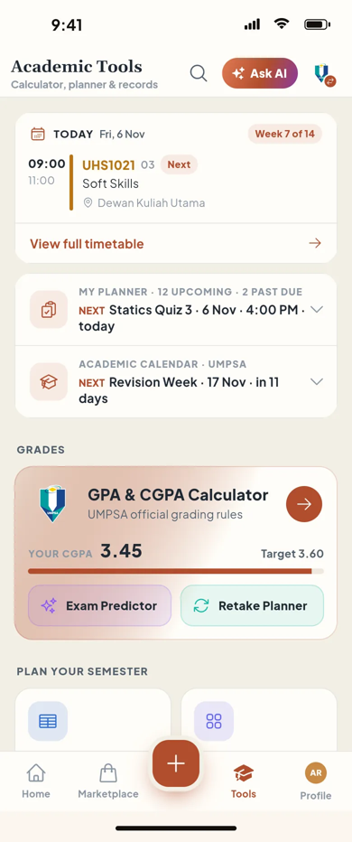
  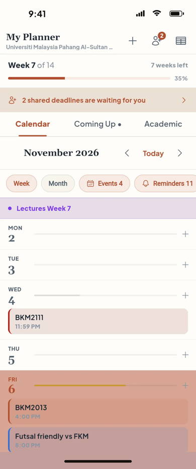
  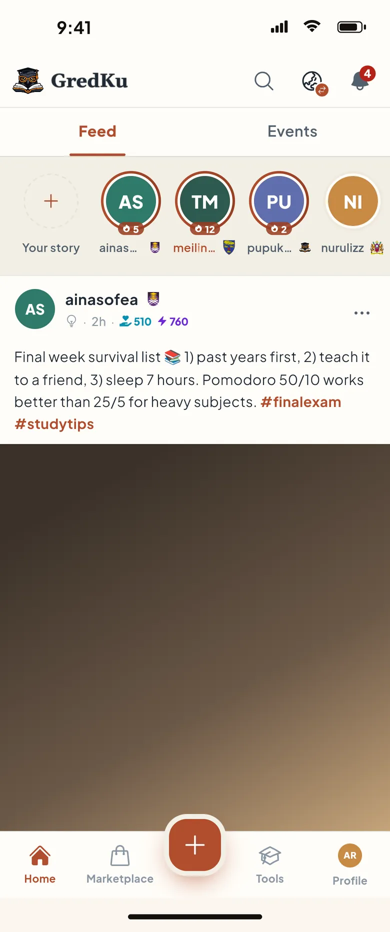

  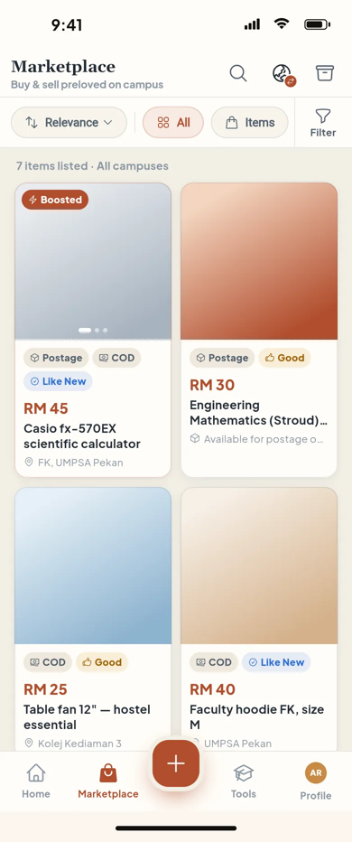
  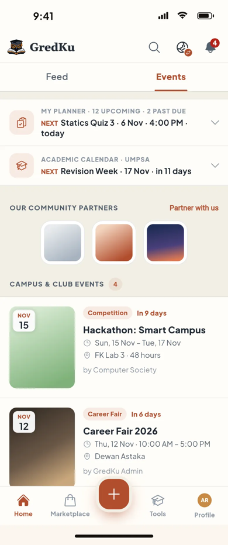
  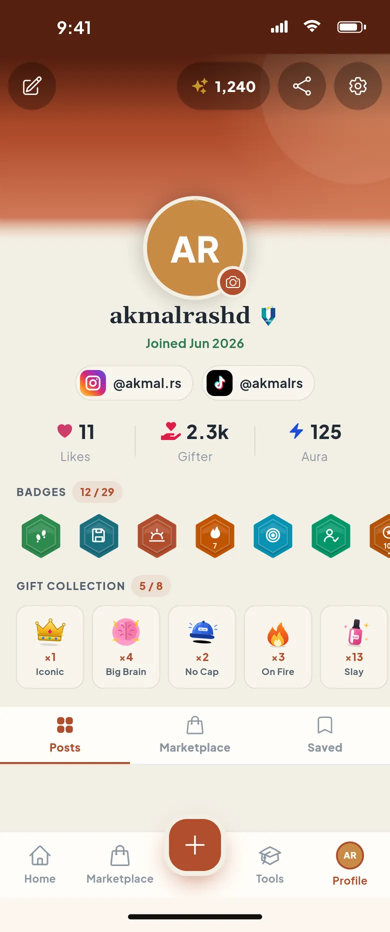

## System design

Diagrams are drawn in draw.io; the editable `.drawio` files are in [`docs/diagrams`](docs/diagrams).

### Architecture
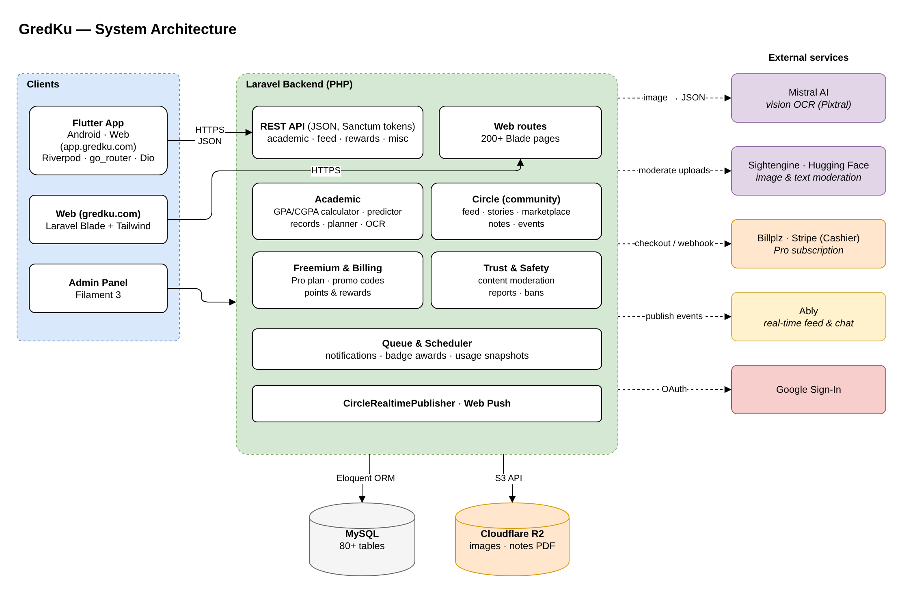

### Flutter app — layers and feature modules
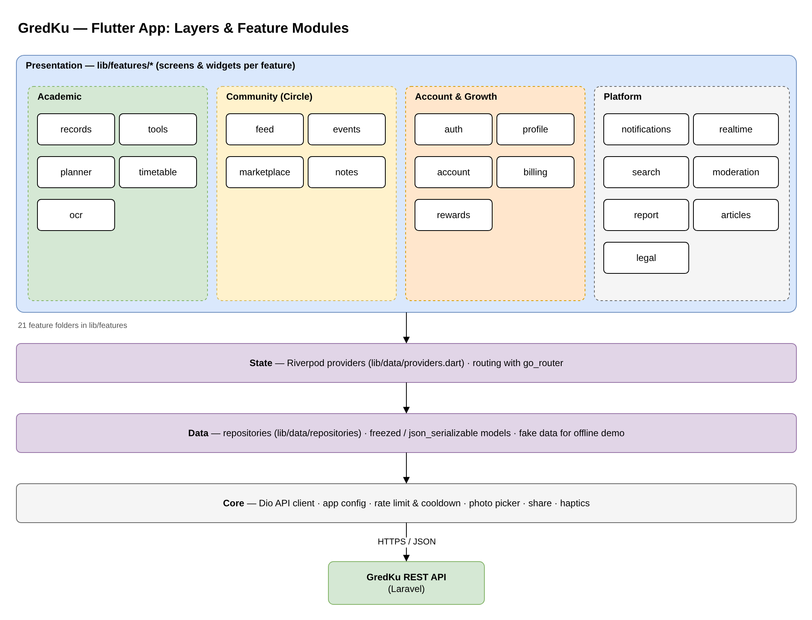

### ERD — academic core
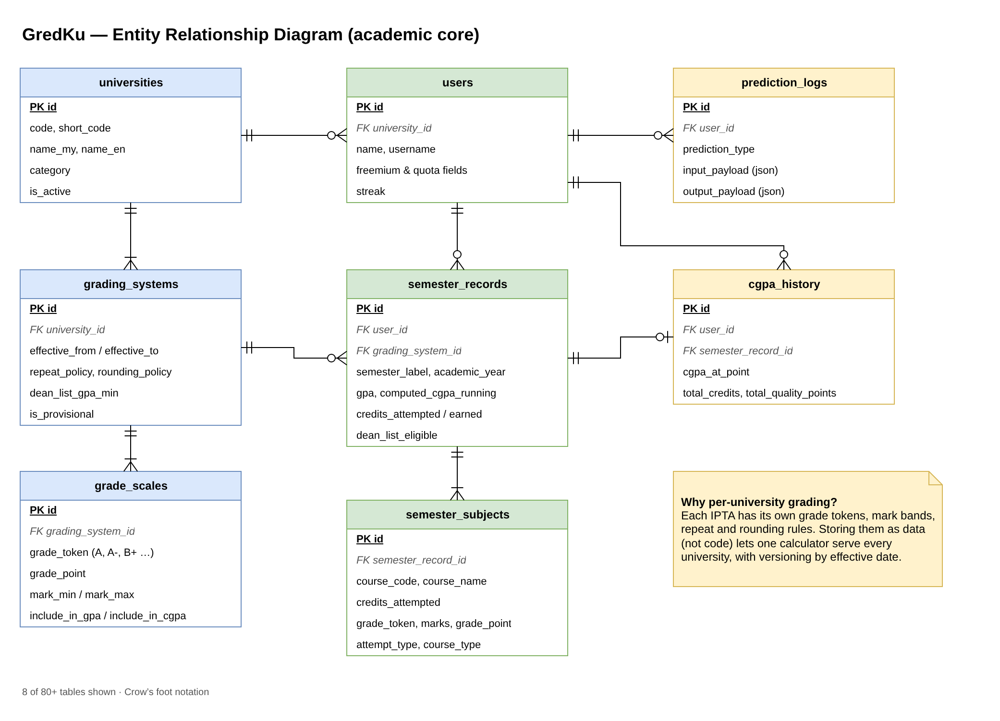

### Sequence — scanning a results slip with OCR
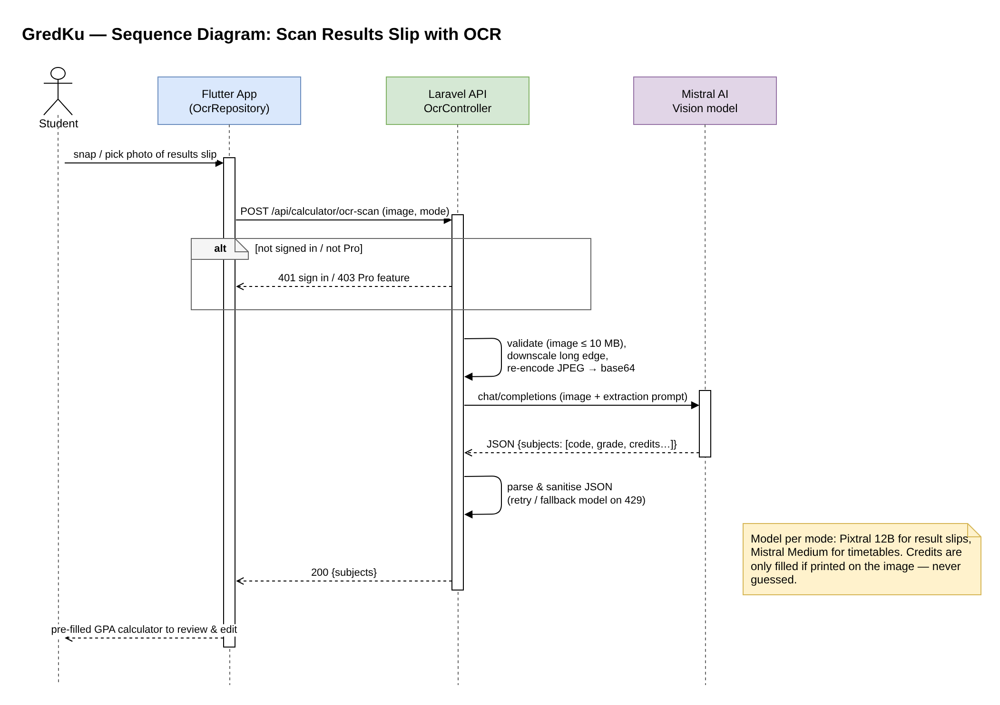

## Engineering decisions

- **Grading rules as data, not code.** `grading_systems` and `grade_scales` are versioned by effective date, so one calculator serves every university and old semesters keep the rules that applied at the time.
- **Feature-first Flutter structure.** 20+ feature folders, each with its own screens, on top of shared Riverpod providers, repositories and a single Dio API client. This keeps features independent and easy to test.
- **Cost-aware AI.** OCR is limited to signed-in Pro users, images are downscaled before upload, and the model is chosen per task (Pixtral for slips, Mistral Medium for timetables), with a fallback when rate-limited.
- **Moderation before publishing.** Community uploads pass through image and text moderation services, backed by user reports and admin tools (Filament).
- **Object storage.** Images and notes PDFs live in Cloudflare R2 (S3 API) instead of the web server disk.

## Tech stack

| Layer | Technology |
|---|---|
| Mobile / web app | Flutter, Dart, Riverpod, go_router, Dio, freezed |
| Backend | Laravel (PHP), Sanctum, Socialite (Google), queues & scheduler |
| Web & admin | Blade, Tailwind CSS, Vite, Filament 3 |
| Data & storage | MySQL, Cloudflare R2 |
| Integrations | Mistral AI (vision OCR), Sightengine & Hugging Face (moderation), Billplz / Stripe (payments), Ably (real-time), Web Push |

## How I used AI tools while building this

AI coding assistants (mainly Claude Code) supported my work as a pair-programmer: generating boilerplate, suggesting refactors, explaining errors and drafting tests. I made the product and design decisions with the CukruDev team, wrote and reviewed the code, and tested the features before release.

The OCR and moderation features are **product features** I integrated through third-party AI APIs; they are not the same as the tools I used to write code.

## Contact

**Muhammad Akmal bin Mohd Rashid** — Co-Founder & Technical Manager, CukruDev Solutions  
Open to a 6-month internship (22 February – 7 August 2027).  
📧 work.akmalrashd@gmail.com · 💼 [linkedin.com/in/akmalrashd](https://www.linkedin.com/in/akmalrashd)

© 2026 CukruDev Solutions. Shared for portfolio viewing only; all rights reserved.
